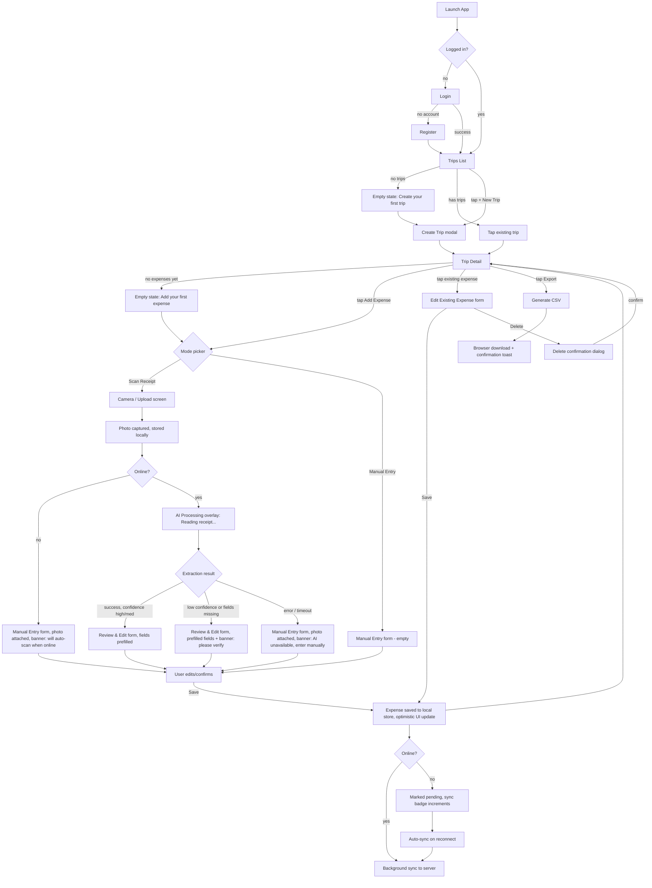

# UX Flow, Design Patterns & Design-Generation Prompt — Expense Report PWA (MVP)

Companion to [TRD.md](./TRD.md). This document is the input for your design pass: it lists every screen, the full navigation flow (including offline/error/failure branches), the UI patterns each screen should follow, and a ready-to-paste prompt for an AI design tool.

## 1. Screen Inventory

| # | Screen | Type |
|---|---|---|
| 1 | Login | Full page |
| 2 | Register | Full page |
| 3 | Trips List (Home) | Full page, primary nav landing |
| 4 | Create Trip | Modal/sheet |
| 5 | Trip Detail (expense list + total) | Full page |
| 6 | Add Expense — mode picker | Modal/sheet |
| 7 | Scan Receipt — camera/upload | Full page |
| 8 | AI Processing (loading) | Overlay state on screen 7 |
| 9 | Review & Edit Expense (AI-prefilled) | Full page / sheet |
| 10 | Manual Entry (empty form) | Full page / sheet — same layout as #9 |
| 11 | Edit Existing Expense | Same component as #9/#10, opened from list |
| 12 | Delete Confirmation | Dialog |
| 13 | Export Trip | Action + confirmation toast (no dedicated page) |
| 14 | Global: Offline banner / sync status | Persistent overlay component |
| 15 | Global: Empty states (no trips, no expenses) | In-page state |

## 2. Full Flow (with branches)



## 3. Design Patterns by Screen

### Global patterns (apply everywhere)
- **Layout**: mobile-first single column, max content width ~480px even on desktop, bottom-safe-area padding for iOS PWA.
- **Navigation**: simple back-stack (no deep tab bar needed for MVP — 3 real destinations: Trips List, Trip Detail, Add/Edit Expense). Use a top app bar with a back chevron + screen title.
- **Offline indicator**: a thin, non-blocking banner pinned under the app bar, e.g. "Offline — changes are saved on this device" (amber). Never a full-screen blocker.
- **Sync status**: small badge near the app title showing pending-sync count (e.g. "2 pending"). Tappable to show what's pending.
- **Loading**: skeleton placeholders for lists, spinner + short status text for AI calls (never a bare spinner with no text).
- **Errors**: inline banners, dismissible, action-oriented ("AI unavailable — enter manually" with the manual form already open beneath it), never a modal dead-end.

### Login / Register (#1, #2)
- Minimal: email + password, single primary CTA, link to switch between the two.
- No social login, no "forgot password" flow needed for MVP (note as a gap, not a blocker).

### Trips List (#3)
- Card list, each card: trip name, date range, running total, expense count.
- Prominent floating/primary "+ New Trip" action.
- Empty state: centered illustration/icon + one-line copy + primary CTA — same button, no separate path.

### Create Trip (#4)
- Bottom sheet (mobile) / centered modal (desktop): name, start date, end date, Create button. Date pickers native where possible (`<input type="date">`) to avoid extra dependencies.

### Trip Detail (#5)
- Header: trip name, date range, total amount (large, prominent).
- List below: expense rows grouped by category with subtotal per category (collapsible groups optional, flat list acceptable for MVP).
- Each row: vendor/merchant, date, amount, category icon, small sync-status dot (synced/pending), tap → Edit Existing Expense.
- Sticky footer or FAB: "Add Expense" (primary) and "Export CSV" (secondary, icon button).

### Add Expense mode picker (#6)
- Two large tappable options, not a dropdown: "📷 Scan Receipt" and "✏️ Manual Entry" — this is a moment to bias users toward AI capture since it's the core value prop, so make Scan Receipt visually primary.

### Scan Receipt (#7) → AI Processing (#8)
- Full-screen camera viewfinder with a receipt-shaped guide overlay; capture button; gallery/upload icon as alternative.
- After capture: photo preview with Retake / Use Photo.
- On "Use Photo": immediately transition to Review form in a **processing state** — show the captured photo thumbnail at the top, fields below as skeleton/shimmer with text "Reading receipt…". Do not use a separate blocking full-screen loader — land on the form shell right away so the transition to filled-in data feels instant once it arrives.

### Review & Edit / Manual Entry (#9, #10, #11)
- Single form, same component for all three entry paths (AI-prefilled, AI-uncertain, manual, edit-existing) — only the initial field values and banner differ.
- Field order: Amount (largest, top — it's what users check first), Vendor, Date, Category (icon-chip selector: Meals/Lodging/Transport/Other), Currency, Notes.
- Each AI-filled field shows a subtle "AI" tag; if `ai_confidence` is low, wrap the field in a highlighted (amber outline) state prompting a check — don't just show a global disclaimer, point at the specific field likely to be wrong.
- Receipt photo thumbnail (if any) pinned at top, tappable to zoom, so the user can visually verify against the form while editing.
- Sticky bottom Save button, disabled until required fields (amount, date, category) are valid.

### Delete Confirmation (#12)
- Standard destructive-action dialog: "Delete this expense? This can't be undone." Cancel / Delete (red).

### Export (#13)
- Single tap from Trip Detail, no separate screen. Triggers CSV download + a toast: "Exported 12 expenses — SF Client Visit.csv".

## 4. State Model Notes for Design

Each expense row visually communicates one of these states — design should give each a distinct, consistent visual treatment (not just color text):
1. `synced` — normal row.
2. `pending` — small dot/icon indicating "saved locally, not yet synced."
3. `needs_review` — AI-extracted but low confidence, not yet opened/confirmed by the user (distinct from a normal AI-confirmed row).

## 5. Ready-to-Paste Design-Generation Prompt

Use this block as-is in an AI design tool (v0, Galileo, Figma AI, etc.) to generate the screens above.

```
Design a mobile-first Progressive Web App called "TripExpense" for capturing and
reviewing business-trip expense receipts, styled clean and professional (business/
fintech feel — think Notion x Ramp), single accent color, generous whitespace,
rounded cards, works well in both light and dark mode.

Screens to design, in this flow order:

1. Login — email + password fields, single primary button "Log in", small link
   "Create an account" below.

2. Trips List (home) — top app bar titled "My Trips", list of trip cards (each
   showing trip name, date range, total spend, expense count), floating primary
   button "+ New Trip" bottom-right. Include an empty state variant: centered
   icon, "No trips yet", button "Create your first trip".

3. Create Trip — bottom sheet with fields: Trip name, Start date, End date,
   primary button "Create".

4. Trip Detail — top app bar with trip name + date range as subtitle, large
   total amount below it, a flat list of expense rows below (each row: category
   icon, vendor name, date, amount right-aligned, small colored dot indicating
   sync status), sticky bottom bar with two buttons: "Add Expense" (primary)
   and "Export CSV" (secondary/icon). Include an empty state: "No expenses yet
   — add your first one".

5. Add Expense mode picker — a small sheet with two large equal-weight tappable
   cards: "📷 Scan Receipt" (visually emphasized, primary accent) and
   "✏️ Manual Entry" (secondary style).

6. Scan Receipt (camera) — full-screen camera viewfinder with a dashed
   receipt-outline guide in the center, a large circular capture button at the
   bottom, small gallery-upload icon to its side.

7. Review & Edit Expense form — receipt photo thumbnail pinned at the top
   (tappable to zoom), then a form: Amount (large, prominent input), Vendor,
   Date, Category (row of icon chips: Meals / Lodging / Transport / Other),
   Currency, Notes (optional, smaller). Some fields show a small "AI" pill tag
   next to the label. One field (e.g. Amount) shown in an alternate "needs
   review" state with an amber outline and small caption "AI wasn't fully sure
   — please check". Sticky bottom "Save Expense" button.

8. Same form in a plain "Manual Entry" state — identical layout, no photo
   thumbnail, no AI tags, fields empty.

9. Delete confirmation — small centered dialog, warning tone, "Cancel" and
   red "Delete" buttons.

Global elements to include as a persistent pattern across screens: a thin
amber banner just below the top app bar reading "Offline — changes saved on
this device" (show this as a separate state variant on the Trip Detail
screen), and a small pending-sync count badge near the app bar title.

Deliver as a mobile screen set (iPhone frame width, ~390px) with a couple of
key screens (Trip Detail, Review & Edit form) also shown in a desktop-width
variant (max content column ~480px, centered, rest of viewport as neutral
background).
```

## 6. How This Maps Back to the TRD

- Screens #7–#11 implement TRD §3 (User Flow) and §7 (AI Extraction Detail), including the mandatory manual-entry fallback on AI failure/low confidence.
- The offline banner and sync badge implement TRD §8 (Offline & Sync Strategy).
- The Trip Detail export action implements the `GET /api/trips/:id/export.csv` endpoint from TRD §6.
- The `sync_status` and `ai_confidence` fields from TRD §5 (Data Model) are what drive the row-state and field-highlight patterns in §4 of this document.
